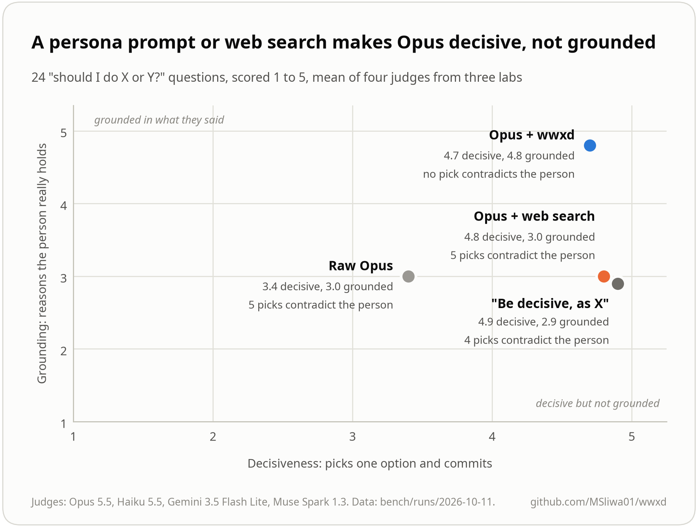

# Benchmarks

The [README](../README.md#results) has the main result: on 40 questions, five judges
from four labs preferred wwxd over raw Opus 5.5 on 34 of 40 up to 40 of 40 pairs.
This page covers the other benches. Full numbers, setup and caveats are in
[bench/RESULTS.md](../bench/RESULTS.md), and the raw answers and judgments are in
[bench/runs/](../bench/runs).

## Opinionated isn't the same as right

The obvious fix for bland answers is to tell the model to be decisive. We tried it
on 24 "should I do X or Y?" questions, with four judges ranking three answers to
each: raw Opus, Opus told to answer decisively as the person would, and Opus with
the vault.

| Mean of four judges, 1 to 5 | Raw | "Be decisive, as X" | wwxd |
|---|---|---|---|
| Decisiveness | 3.5 | 4.8 | 4.7 |
| Distinctiveness | 2.8 | 3.0 | 4.8 |
| Grounding (reasons they hold) | 2.8 | 2.6 | 4.9 |
| Ranked best | 0 | 0 | 93 of 93 |
| Pick contradicts the person | 9 | 8 | 0 |

The persona prompt stops the hedging, but its reasons are generic or invented. Asked
"I have $50k saved, should I pay off my car loan or put it into my business?", it
said to keep the low-rate loan, the standard financial-advice answer. Hormozi says
"ideally just pay off your car so you don't have to think about it again" and that
he skews "very close to the Ramsey side". wwxd quoted both.

The current prose answer format ranked first on 20 of 24 opinion questions, ahead of
the earlier format and raw Opus, with both an Opus and a Gemini judge
([details](../bench/RESULTS.md#answer-format-prose-with-sources-underneath)).

## Isn't web search enough?

We gave Opus 5.5 only web search and told it to find what the person said, answer
decisively and cite its pages. Against Opus with a wwxd vault, both at effort high,
the judges preferred wwxd on 39 of 40 main-bench questions (Opus 5.5), 38 of 40
(Haiku 5.5), 34 of 40 (Gemini 3.5 Flash Lite) and 33 of 35 (Muse Spark 1.3). On the
12 questions about 2026 material, the Opus judge picked wwxd every time.

Search finds a person's well-known positions, but mostly through other people's
summaries. For Hormozi, the most cited sites were shortform.com and podscripts.co,
and 5 of 156 links went to YouTube or acquisition.com. It misses the specifics and
can't check a quote. When the judges ranked all four answers to each opinion
question together, web search was about as decisive as the persona prompt, its
grounding averaged 3.0 against 4.8 for wwxd, and 5 of its picks contradicted the
person ([details](../bench/RESULTS.md#web-search-vs-a-vault)).

## Questions they never answered

On 16 questions the people never addressed ("would Hormozi buy a Lamborghini after
his first $1M?"), wwxd works it out from the nearest thing they did say and the rule
behind it. Every judgment ranked a wwxd answer first. Grounding was 4.7 against 2.3
for the persona prompt, and the inference itself scored 4.5 of 5 with thinking
pages.

## What wwxd doesn't do

It doesn't predict. We rebuilt both vaults from pre-2026 sources only and asked about
positions the people first took in 2026. The vault answers were no better than raw
Opus. One judge called it even, and three others preferred raw Opus. Thinking pages
didn't change that. A thinking style settles a judgment call. It can't recover a fact
or a number the person hadn't said yet. A vault keeps answers faithful to what
someone has said, but it can't know what they'll say next, so keep it current with
`wwxd update` ([Keep a vault current](keeping-current.md)).

## Voice check case studies

`wwxd voice` checks who said each quote by comparing the audio with each member's
voiceprint (see the [README](../README.md#check-who-said-it-by-voice)). On our test
vaults it checked 1,423 statements from 26 videos in under 4 minutes on CPU. It
flagged 9 as spoken by someone else. We could verify 6 of them.

- In a Sam Altman and Garry Tan conversation, 3 lines the compile credited to Tan
  were Altman's. The official speaker-labelled transcript confirms all 3. Across the
  54 statements from that episode we could match to the official transcript, the
  compile got 51 right and the voice check got all 54.
- In a Dalton Caldwell and Michael Seibel episode, 2 teaser lines credited to Dalton
  match Michael's voice, and the intro right after them is "hey this is Michael
  Seibel with Dalton Caldwell".
- In a Hormozi consulting call, a line credited to Hormozi sits in the business
  owner's turn, where he explains his own sales process.

The other 3 flags are in Dalton and Michael episodes with no official transcript, so
they're still unconfirmed.
