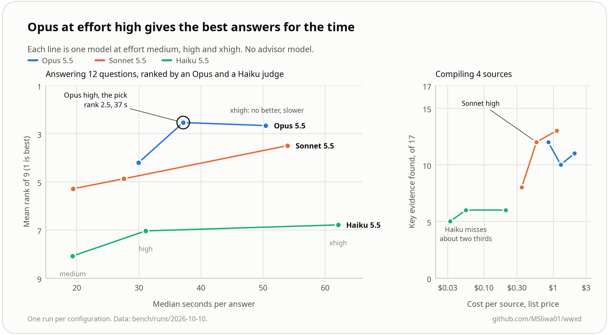

# Models and cost

The [README](../README.md#what-it-costs) has the short version: what a video, a
podcast and a question cost, and how to run `wwxd estimate`. This page explains where
those numbers come from and which model to use for each job.

## Where the cost table comes from

Most of the compile cost is fixed, because the agent rereads the skill, the index and
the pages it touches for every source. So a vault of 15 long videos costs about $20
to $30 on Opus.

The README's table comes from runs at effort xhigh with a Fable 5.1 advisor turned
on, and counts only the main model's tokens. The advisor added 85% to 125% on top,
so with an advisor the cost roughly doubles. Without one, the main model does that
thinking itself. In our model and effort study, with no advisor, Opus cost about 0.7
times the table per source at effort medium, about the same at high, and 1.75 times
at xhigh. `wwxd estimate` prints these factors. Sonnet compiled about as well as Opus
for less, and Haiku missed about two thirds of the key evidence.

## Which model and effort

We compared Opus 5.5, Sonnet 5.5 and Haiku 5.5 at Claude Code effort medium, high
and xhigh, for both compiling and answering, with no advisor.



| Job | Use | Why |
|---|---|---|
| Compile | Sonnet high, or Opus medium if you're on Opus anyway | Both found 12 of the 17 key evidence quotes, and Sonnet high cost about two thirds as much. xhigh writes a denser vault for 2 to 3 times the time and cost but didn't find more of the key evidence. Haiku missed about two thirds of it. |
| Answer | Opus high | Opus xhigh wasn't clearly better and took longer. On a tighter budget, Sonnet xhigh ranked about as well as Opus medium. Haiku ranked last at every effort and got about 1 quote in 20 wrong. |
| Triage | A cheap model | See [Use a cheaper model for triage](#use-a-cheaper-model-for-triage). |

You don't need an advisor model. Numbers and limits are in
[bench/RESULTS.md](../bench/RESULTS.md#model-and-effort-study).

## Use a cheaper model for triage

Deciding which candidate videos to keep only needs titles, channels and durations,
so a small, cheap model can do it. Keep the strong model for compiling and
answering. That's where attribution happens, and lint can catch an invented quote
but not a real quote credited to the wrong person.

## Compile many sources at once

Compiling one source at a time takes a few minutes per source, so a vault of 70
videos takes an afternoon. `wwxd compile` runs several Claude Code sessions at once,
each compiling one source into the same wiki.

```bash
wwxd compile hormozi --jobs 4                     # Sonnet 5.5 at effort high by default
wwxd compile hormozi --jobs 4 --model claude-opus-5-5 --effort medium
```

On the 4 sources of the model and effort study, 3 sessions at once finished in 3.6
minutes instead of 12, for the same cost ($2.37 against $2.30), and found the same
12 of 17 key evidence quotes
([details](../bench/RESULTS.md#parallel-compile)).
The sessions follow rules for the pages they share (`references/compile.md`), and
`wwxd mark-compiled` writes `sources.yaml` under a lock. With many sessions on one
vault, expect a few near-duplicate leaves. Run `wwxd health` afterwards and let the
agent consolidate what it flags.

Your machine only waits on the agent, so your API rate limits or subscription usage
limit `--jobs`, not your CPU. The total cost doesn't change. You spend it faster.
`--agent-cmd 'opencode run -m {model} {prompt}'` uses another agent CLI.
